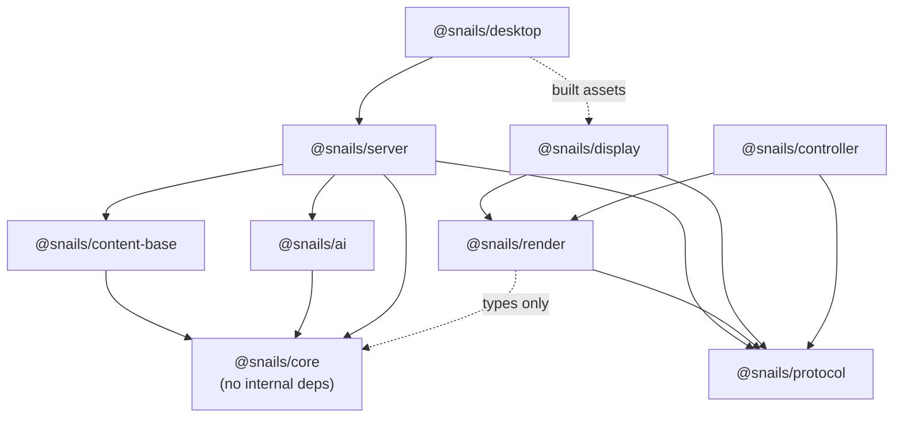
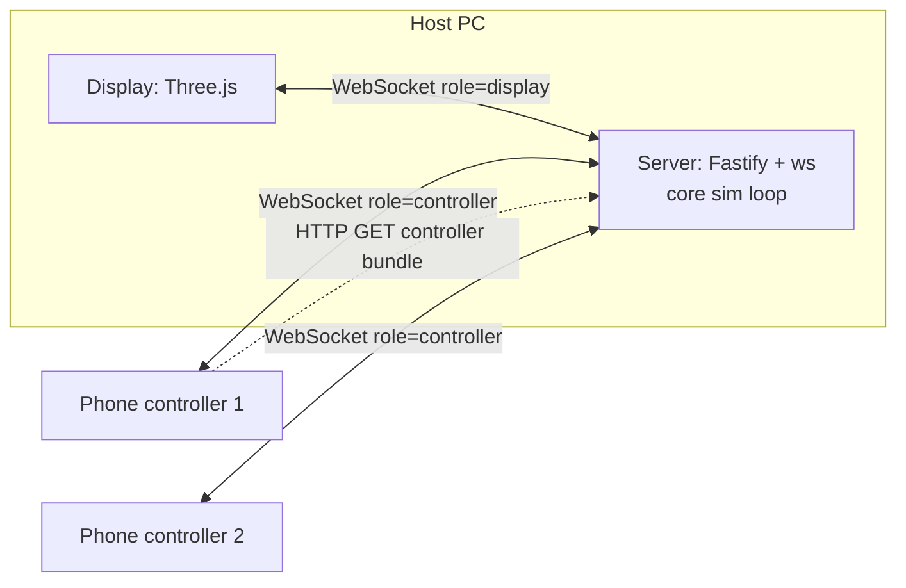
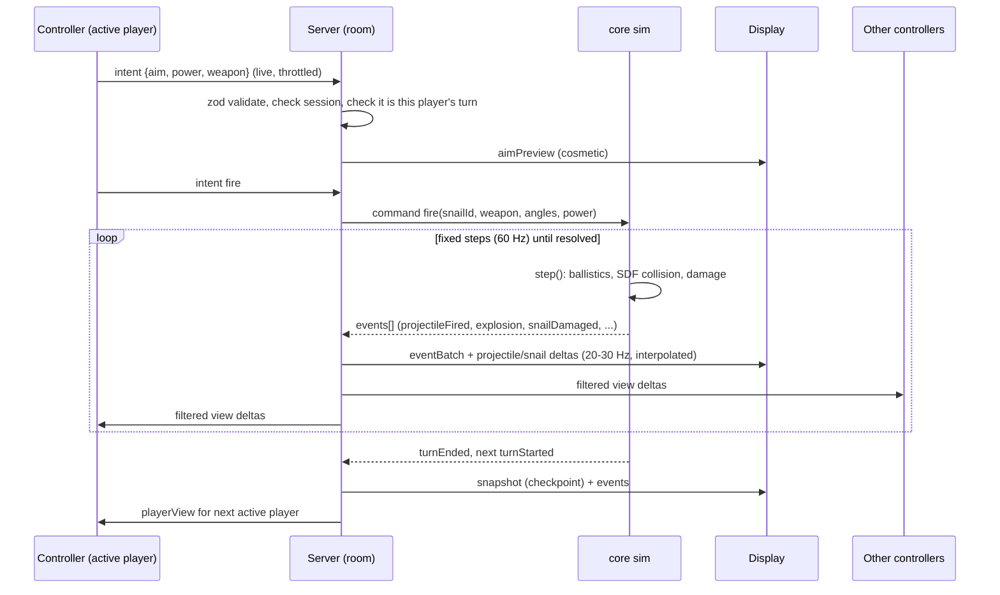

# Architecture

## Components

| Component | Package | Runs in | Responsibility |
| --- | --- | --- | --- |
| Simulation | `@snails/core` | Node (server), browser (AI/preview), tests | State, turn manager, terrain SDF, ballistics, damage, research, event bus, seeded RNG, `ContentRegistry`. Pure TS, no DOM/Node APIs. |
| Protocol | `@snails/protocol` | everywhere | zod schemas + inferred TS types for every message, `PROTOCOL_VERSION`. |
| Base content | `@snails/content-base` | server (and display for visuals) | Weapons, techs, shell upgrades, maps as definitions. |
| AI | `@snails/ai` | server | CPU strategies; plans by forking core state. |
| Server | `@snails/server` | Node 22 | Fastify (static controller bundle, `/api/info`), `ws` WebSocket, rooms/lobby, authoritative sim loop, LAN IP + QR. |
| Render | `@snails/render` | browser/Electron/phone | Shared Three.js view library: scene, terrain mesher worker, shell materials, VFX, camera, quality tiers. Pure view ([ADR-0008](adr/0008-phone-renders-game-view.md)). |
| Display | `@snails/display` | browser/Electron | Big-screen app: wraps `@snails/render` with high tier, lobby/QR screens, audio. |
| Controller | `@snails/controller` | phone browser | Join, lobby, aim/power/weapon/research UI plus 3D view via `@snails/render` (mobile tier). Sends intents. |
| Desktop | `@snails/desktop` | Electron | Starts server, opens display, packaging. |

## Package dependency graph



Rules: `core` imports nothing internal. `render` is the only package holding Three.js scene code and is shared by display and controller. `protocol` is standalone (core types only if unavoidable). `display` and `controller` never import `server`. The controller must not import `core` (only `render`, which uses core types), which prevents rules leaking into the client; the renderer is lazy-loaded to keep join fast. ESLint `no-restricted-imports` enforces the graph.

## Runtime topology



The display is just another WebSocket client with the `display` role, so the same code runs in Electron or a browser tab on another machine (e.g. a TV browser).

## Turn data flow



Invalid intents (wrong turn, unknown weapon, not researched, out-of-range values) are rejected with an `error` message and never reach the sim.

## Fixed-timestep loop

The server owns the clock. Simulation time is decoupled from wall time:

```ts
const DT = 1 / 60;
let acc = 0, last = now();
setInterval(() => {            // 4-8 ms timer; use setImmediate-style drift correction
  const t = now(); acc += Math.min(t - last, 0.25); last = t;   // clamp to avoid spiral of death
  while (acc >= DT) { events.push(...sim.step(DT, pendingCommands.drain())); acc -= DT; }
  if (broadcastDue(t)) publish(sim, events.splice(0));
}, 5);
```

- The sim is idle between turns (only waiting for intents and timers tick), so CPU use is low.
- Commands are applied at the start of a step with a monotonically increasing `tick`, so a replay is `(seed, content hash, [(tick, command)])`.
- The display renders at monitor refresh rate and interpolates between the last two received states; it never steps the rules.

## State sync strategy

Server-authoritative. Clients never send state.

| Client | Receives | Frequency | Notes |
| --- | --- | --- | --- |
| Display | Full `snapshot` on join/reconnect and at turn boundaries; `delta` (entity transforms) while projectiles fly; ordered `events` for VFX/audio; terrain `edits` (centre, radius, tick) | deltas ~20-30 Hz, events immediate | Interpolates with ~100 ms buffer. Rebuilds terrain from map seed + edit list. |
| Controller | Same snapshot/delta/terrain-edit/event stream as the display (so the phone renders the world), plus `playerView`: own team detail (inventory, research, ammo), turn state, wind | deltas ~20-30 Hz (may be lowered on mobile), views on change | Filtered: no other teams' private data (e.g. hidden research choices, stock). |
| Spectator | Same as controller public view | on change | No intents accepted. |

Events carry a `tick` and monotonically increasing `seq`; clients detect gaps and request a snapshot (`resync`). Snapshots include `seq` so deltas can be applied idempotently.

## Where each concern lives

| Concern | Location |
| --- | --- |
| Rules, damage, turn order, win conditions | `core` |
| Terrain data and carving, collision | `core` (SDF); meshing in `display` worker |
| Research tree logic | `core`; tree content in `content-base` |
| CPU decisions | `ai` (calls `core` to simulate) |
| Message shapes, validation, versioning | `protocol` |
| Rooms, sessions, auth tokens, timers, heartbeats | `server` |
| Sim loop scheduling and broadcast | `server` |
| Rendering, shaders, terrain meshing, camera, particles | `render` (shared) |
| Big-screen composition, audio, QR/lobby screens | `display` |
| Touch UI, haptics, local prefs, mobile quality selection | `controller` |
| Process lifecycle, packaging | `desktop` |
| Visual-only randomness | `display` (separate RNG, never affects sim) |

## Cross-cutting rules

- Determinism: no `Math.random`/`Date.now` in `core` ([ADR-0004](adr/0004-deterministic-simulation.md)).
- Everything crossing a process boundary is a zod-validated protocol message.
- The content hash (registry contents) is exchanged on join; mismatches are rejected for display clients and warned for controllers.
