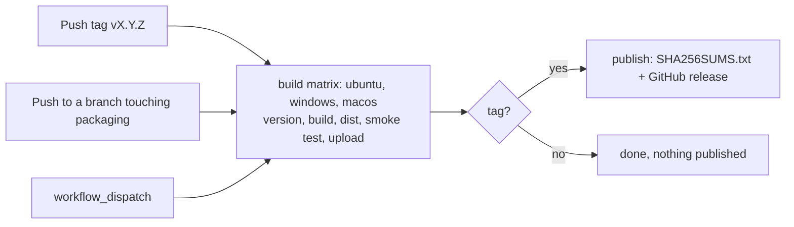

# Release process

## Versioning

Semantic versioning for the game and all workspace packages (the desktop app version is set from the release tag at build time):

- **MAJOR**: breaking protocol or content API change (also bumps `PROTOCOL_VERSION` / `CONTENT_API_VERSION`), or incompatible replay changes.
- **MINOR**: new features, content, maps, weapons.
- **PATCH**: bug fixes, balance tweaks that do not change schemas.
- Pre-releases: `v0.3.0-rc.1`. Pre-1.0, minor bumps may contain breaking changes (documented in the changelog).

## Changelog

`CHANGELOG.md` at the repo root, [Keep a Changelog](https://keepachangelog.com) format, edited by hand at player level. Sections: Added, Changed, Fixed, Removed, Balance, Breaking.

The release workflow runs `node scripts/changelog-section.mjs <version>` and uses the output as the release body. The script finds the first `## ` heading that starts with the version, with or without brackets or a leading `v` (`## [0.2.0] - 2026-01-31`), and prints everything up to the next `## ` heading. If there is no matching heading the body is empty and only the generated notes remain. Check locally: `node scripts/changelog-section.mjs 0.2.0`.

## Workflow overview (`.github/workflows/release.yml`)

Triggers:

- **Tag `v*.*.*`**: real release (see below).
- **Branch dry run**: a push to any branch that touches `apps/desktop/**`, `scripts/desktop-smoke.mjs` or the workflow file builds all three OSes and runs the smoke test. It never publishes. Use it to validate packaging changes before merging.
- **Manual dry run**: Actions > Release > Run workflow (`workflow_dispatch`), with a `version` input (default `0.0.0-dryrun.1`). Same as the branch dry run, never publishes. Without an input (or on a branch push) the version is `0.0.0-ci.<run number>`.

Jobs:

- `build` (matrix `ubuntu-latest`, `windows-latest`, `macos-latest`): derive the version (tag name without `v`, else the dispatch input, else `0.0.0-ci.N`), fail unless it is semver, set it in `apps/desktop/package.json` (`npm pkg set version`), then `pnpm install --frozen-lockfile`, `pnpm build`, `pnpm --filter @snails/desktop dist`, the installer smoke test (below), and upload the `.AppImage`, `.exe` and `.dmg` as workflow artifacts (`snails-<os>`).
- `publish` (`needs: build`, tags only): downloads all artifacts, writes `SHA256SUMS.txt`, extracts the `CHANGELOG.md` section for the version, and creates the release once with `softprops/action-gh-release` (files `dist/*`, changelog section as body, `generate_release_notes: true`, so GitHub appends its generated notes). Tags containing `-` (e.g. `v0.1.0-rc.1`) are marked as pre-releases.
- Concurrency: one run per ref; a newer push cancels an in-progress branch run, but tag runs are never cancelled.
- Code signing and macOS notarisation are not set up: builds are unsigned, so Windows SmartScreen and macOS Gatekeeper warn on first launch. When certificates exist, supply them via repository secrets (`CSC_LINK`, `CSC_KEY_PASSWORD`, `APPLE_ID`, ...).

## Release checklist

Versions come from the tag; there is nothing to bump in the repo.

1. Pick the version (see Versioning) and check that `main` CI is green (lint, typecheck, check-limits, test, build) and that the latest packaging dry run on `main` passed.
2. Update `CHANGELOG.md`: rename the `## [Unreleased]` entries into `## [X.Y.Z] - YYYY-MM-DD` and confirm `node scripts/changelog-section.mjs X.Y.Z` prints the notes you expect.
3. Commit (`docs: changelog for vX.Y.Z`), open a PR, merge to `main`, and wait for CI to be green again.
4. Tag the merge commit and push the tag: `git switch main && git pull && git tag vX.Y.Z && git push origin vX.Y.Z`. For a trial use `vX.Y.Z-rc.1` (pre-release).
5. Watch the Release workflow: three build jobs plus `publish`. A failed smoke test blocks publishing.
6. Open the GitHub release page and check: installers for Windows (`.exe`), macOS (`.dmg`), Linux (`.AppImage`), `SHA256SUMS.txt`, the changelog section at the top, and the pre-release flag only for `-` tags.
7. On a real machine, download an installer, verify it (`sha256sum -c SHA256SUMS.txt`), install, launch, and join from a phone on the same Wi-Fi (see [troubleshooting.md](../troubleshooting.md)). Ideally cover at least one OS besides the one you develop on.

## Retracting a bad release

Tags are never moved or reused.

1. On the release page, edit the release and tick **Set as a pre-release** (or revert to draft) so it is no longer "latest", and add a warning line to the notes. Delete the release only if it is dangerous or broken beyond use.
2. Fix forward: branch from the tag if needed (`git switch -c hotfix/0.2.1 v0.2.0`), fix, merge to `main`, then tag the next patch `v0.2.1` via the checklist above.
3. Optionally delete the bad tag (`git push origin :refs/tags/vX.Y.Z`) only when nothing was downloaded; still do not reuse the version number.

## Installer smoke test

`scripts/desktop-smoke.mjs` launches the packaged app (Linux AppImage with `--appimage-extract-and-run --no-sandbox` under `xvfb-run`; Windows `win-unpacked/*.exe`; macOS `Snails.app`), reads the `Snails join URL:` line, polls `/api/info` until 200 and checks `/display/` and `/` return HTML. The release workflow runs it after `dist` on every OS. Locally on Linux: `pnpm build && pnpm --filter @snails/desktop dist && xvfb-run -a node scripts/desktop-smoke.mjs`. The Linux executable is named `snails` (`executableName`).
