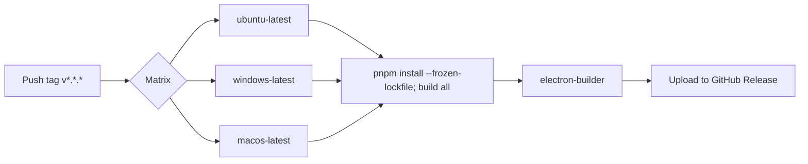

# Release process

## Versioning

Semantic versioning for the game and all workspace packages (kept in lockstep, set from the root `package.json` version):

- **MAJOR**: breaking protocol or content API change (also bumps `PROTOCOL_VERSION` / `CONTENT_API_VERSION`), or incompatible replay changes.
- **MINOR**: new features, content, maps, weapons.
- **PATCH**: bug fixes, balance tweaks that do not change schemas.
- Pre-releases: `v0.3.0-rc.1`. Pre-1.0, minor bumps may contain breaking changes (documented in the changelog).

## Changelog

`CHANGELOG.md` at the repo root, [Keep a Changelog](https://keepachangelog.com) format, generated from conventional commits (e.g. `changelogen` or `release-please`) and edited by hand for readability. Sections: Added, Changed, Fixed, Removed, Balance, Breaking.

## Cutting a release

1. Ensure `main` is green (CI: lint, typecheck, check-limits, test, build).
2. Update version: `pnpm version:set 0.2.0` (sets root and workspace versions) and finalise `CHANGELOG.md`.
3. Commit `chore(release): v0.2.0`.
4. Tag and push: `git tag v0.2.0 && git push origin main v0.2.0`.
5. The tag triggers `.github/workflows/release.yml`.

## release.yml

- Matrix: `ubuntu-latest`, `windows-latest`, `macos-latest`, each: checkout, setup pnpm + Node 22, `pnpm install --frozen-lockfile`, `pnpm build`, `pnpm -F @snails/desktop dist` (electron-builder).
- Artifacts: Windows NSIS installer `.exe`, Linux `.AppImage` and `.deb`, macOS `.dmg` (and `.zip`), named `Snails-<version>-<os>-<arch>.<ext>`.
- Upload with `softprops/action-gh-release` (draft release created from the tag, body from the changelog section) or electron-builder's GitHub publisher with `GH_TOKEN: ${{ secrets.GITHUB_TOKEN }}`; `permissions: contents: write`.
- Code signing and macOS notarisation are not set up yet: builds are unsigned, so Windows SmartScreen and macOS Gatekeeper warn on first launch. When certificates exist, supply them via repository secrets (`CSC_LINK`, `CSC_KEY_PASSWORD`, `APPLE_ID`, ...).
- After the matrix completes, review the draft release, check the artifacts launch, then publish.

## Running the game from a release

1. Download the artifact for your OS from the GitHub Releases page.
2. **Windows**: run the installer (SmartScreen: More info > Run anyway), launch Snails. **Linux**: `chmod +x Snails-*.AppImage && ./Snails-*.AppImage` (or install the `.deb`). **macOS**: open the dmg, drag to Applications, right-click > Open the first time.
3. Allow network access when the firewall asks (Windows: tick **Private networks**; see [networking.md](../networking.md#windows-firewall-notes)).
4. Connect the PC to a TV/monitor and use the fullscreen toggle (F11).

## Joining from a phone

1. Phone and PC must be on the same Wi-Fi/LAN (not a guest network with client isolation).
2. The host screen shows a QR code and a room code such as `KQ7M`.
3. Open the phone camera (or any QR scanner) and tap the link; it opens `http://<host-ip>:8080/?room=KQ7M` in Chrome. No install needed. Optionally "Add to Home screen" for fullscreen.
4. Enter your name, pick a team/colour, tap Ready.
5. If the QR fails: type the URL shown on screen, or open `http://<host-ip>:8080` and enter the room code.
6. Dropped connection: reopen the page; you rejoin your slot automatically within two minutes.

## Hotfixes and rollbacks

Branch from the tag (`git switch -c hotfix/0.2.1 v0.2.0`), fix, merge to `main`, tag `v0.2.1`. A bad release is marked as pre-release/deleted on GitHub and superseded by a patch; tags are never moved.
