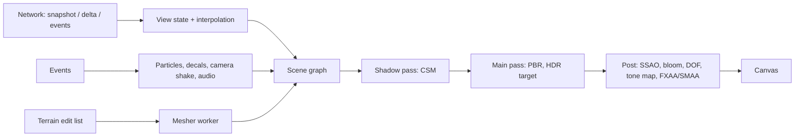
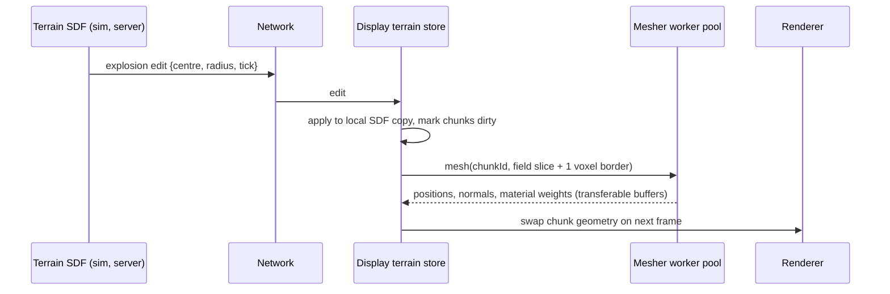

# Graphics

The rendering code lives in `packages/render` (`@snails/render`), shared by the big-screen display (`apps/display`) and the phone controller (`apps/controller`) ([ADR-0008](adr/0008-phone-renders-game-view.md)). It is a pure view of simulation state ([ADR-0002](adr/0002-threejs-rendering.md)). Target: 60 fps at 1920x1080 on a mid-range GPU (GTX 1660 / RX 580 / Apple M1 class) in the "High" tier.

## Pipeline overview

Scene rendering uses an HDR (half-float) render target; tone mapping happens at the end of the post chain. The `postprocessing` library (pmndrs) is used for effect merging so that SSAO/bloom/tone-mapping run in few passes.

## Materials and lighting

- **PBR**: `MeshStandardMaterial` / `MeshPhysicalMaterial` with metalness-roughness workflow. Snail bodies use sheen/subsurface-like tricks (cheap: fresnel rim + wet clearcoat); shells use `MeshPhysicalMaterial` with clearcoat for lacquered upgrades. Details of shell shaders in [snail-visuals.md](snail-visuals.md).
- **HDRI environment**: a prefiltered equirect HDRI (PMREM) drives image-based lighting and reflections; a few time-of-day/biome HDRIs ship with maps. One directional "sun" light matches the HDRI's sun direction for shadows.
- Textures: KTX2/Basis compressed, 1-2K for terrain triplanar sets (albedo, normal, ORM packed), mipmapped, anisotropy 8 on High.

## Shadows

- **Cascaded shadow maps** (3 cascades on High; 2 on Medium; single map on Low) for the sun, via three's CSM addon or a custom implementation. Cascade splits are practical (log/linear blend), fitted to the playfield bounds rather than the full frustum.
- **Soft shadows**: PCF soft (Vogel disk sampling) on High, PCF 2x2 on Medium. Shadow map 2048 per cascade (High).
- Shadow casting limited to terrain chunks near snails, snails, projectiles and large props; small VFX do not cast.
- Terrain chunk shadow geometry reuses the chunk mesh (no separate LOD).

## Post-processing

| Effect | Purpose | Tier |
| --- | --- | --- |
| SSAO (GTAO or N8AO) | Contact shadowing in craters/crevices | High, Medium (half-res) |
| Bloom (selective, threshold on emissive) | Explosions, glowing tech | High, Medium |
| Tone mapping (ACES Filmic or AgX) | HDR to display range | All |
| DOF (bokeh) | Only during aiming/cinematic cams to isolate the active snail | High |
| FXAA/SMAA | Anti-aliasing | SMAA High, FXAA Medium, none Low (use MSAA 4x on low-res target if affordable) |
| Vignette / colour grade LUT | Art direction | High |

DOF is driven by the camera system: focus distance tracks the active snail, aperture eases in over 300 ms when the aim camera engages and out when a projectile flies.

## Terrain rendering

Terrain data is a chunked 3D SDF in `@snails/core` ([ADR-0005](adr/0005-destructible-sdf-terrain.md)).

- **Chunks**: 32^3 cells (+1 border for seams). The display keeps its own SDF copy, built from the map seed/generator and replayed edits (or received as compressed chunks on join), so the server never streams meshes.
- **Marching cubes** (or surface nets as a fallback if quad topology is wanted) runs in a pool of Web Workers (`min(4, hardwareConcurrency-2)`). Input/output use transferable `Float32Array`/`Uint32Array`. Normals come from the SDF gradient for smooth shading.
- **Dirty-only re-mesh**: an explosion marks only chunks whose bounds intersect the carve sphere (expanded by one cell). Requests are coalesced per frame and prioritised by distance to camera/impact. The old mesh stays until the new one arrives to avoid flicker.
- **Material blending**: per-vertex weights (rock/dirt/grass/sand) derived from slope, height, and a "scorch" mask written near explosions. **Triplanar texturing** blends three projections by normal to avoid stretching on cliffs; implemented in a `onBeforeCompile` patch on `MeshStandardMaterial`, or a TSL node material after WebGPU migration.
- **Crater detail**: scorched rim via the scorch vertex attribute; dust/debris particles spawned by the explosion event.
- Frustum culling per chunk; empty/full uniform chunks produce no mesh.
- Budget: a typical blast re-meshes 4-12 chunks; worker time < 4 ms per chunk, so the new geometry appears within 1-3 frames.

## Water

A single large plane at the map's water level: Fresnel-blended reflection from the environment probe (planar reflection only on High), animated normal maps for ripples, depth-based colour/foam using the depth buffer, and splash particle + sound on events. Snails or projectiles that cross the plane emit `snailDrowned`/splash events from core; the view only reacts.

## Particles and VFX

- GPU instancing (`InstancedMesh`/`Points` with custom shader) pooled by effect type; no per-frame allocations.
- Explosion = flash light (short-lived PointLight pooled, max 2) + fireball sprites + sparks + smoke + debris meshes + shockwave ring + camera shake scaled by yield/distance.
- Event-driven: each core event type maps to a VFX recipe registered by content (weapon definition's `vfx` id), keeping visuals data-driven ([extensibility.md](extensibility.md)).
- Trails: projectile ribbon trails, fading by age.
- Visual RNG is independent of the sim RNG.

## Camera system

A small state machine of cameras with blended transitions (critically-damped spring):

| Mode | Behaviour |
| --- | --- |
| Overview | Wide orbit-able shot of the map between turns, framing all snails. |
| Aim | Over-the-shoulder behind the active snail, yaw/pitch follow controller intent, DOF on. |
| Follow projectile | Chase cam that looks ahead of velocity, pulls back with speed, avoids terrain via SDF sampling. |
| Impact cinematic | Brief slow-motion/zoom on kills or big hits (time-scale applies to *view interpolation only*, never to the sim). |
| Replay/Free | Debug fly cam. |

Camera collision samples the SDF (cached on the display) so cameras never end up inside terrain.

## Quality tiers and budgets

| Setting | Low | Medium | High (target) |
| --- | --- | --- | --- |
| Resolution scale | 0.75 | 1.0 | 1.0 |
| Shadows | 1 map 1024, PCF | 2 cascades 1024 | 3 cascades 2048, soft |
| SSAO | off | half-res | full |
| Bloom / DOF | bloom only | bloom | bloom + DOF |
| AA | FXAA | FXAA | SMAA |
| Terrain chunk worker count | 1 | 2 | 4 |
| Particle cap | 1k | 3k | 8k |
| Planar water reflection | off | off | on |

### Mobile tier (phone controller)

Used by `apps/controller` by default; selected from a device probe (GPU string, `deviceMemory`, a 2 s warm-up benchmark) and user-overridable.

| Setting | Mobile |
| --- | --- |
| Target | 30-60 fps on mid-range Android (Snapdragon 6/7-series class); 30 fps cap while idle/between turns |
| Resolution | Adaptive DPR: start at min(devicePixelRatio, 1.5), scale 0.6-1.5 to hold frame time |
| Shadows | Single 1024 map, hard/PCF 2x2, short range around active snail (or blob shadows when thermally throttled) |
| Post | No SSAO, no DOF; optional cheap bloom off; tone mapping + FXAA only |
| Terrain | Lower LOD: coarser marching-cubes step (2 cells) beyond ~40 m, 1 mesher worker, no triplanar on far chunks (single albedo + normal) |
| Particles | Cap 800, no light flashes (emissive sprites instead) |
| Water | Flat shader, no planar reflection |
| Textures | KTX2, 512-1K, anisotropy 2 |

Thermal and battery: render on demand when nothing animates (idle between turns, 10 fps camera drift or paused); drop to 30 fps cap after 60 s of sustained frame-time overrun or when the Battery API / `visibilitychange` indicates saver/background; pause rendering entirely when the tab is hidden or the screen locks. Keep the screen awake with the Wake Lock API only during an active match. A "controls only" setting disables the renderer for weak devices or battery saving.

Frame budget at 60 fps = 16.6 ms: scene+shadows 6 ms, post 3 ms, terrain/mesh upload 1 ms, JS update + VFX 2 ms, headroom 4 ms. Targets on High: draw calls < 800, triangles < 1.5 M visible, GPU memory < 1.5 GB, shader compile hitches avoided by warm-up pass during loading. An auto-quality governor lowers tier if the 1 s average frame time exceeds 20 ms for 5 s (with hysteresis; user override available). A debug overlay (stats.js-style plus draw calls, worker queue length) is toggled with F3.

## WebGPU migration path

1. Keep all materials behind a `materials/` factory; avoid raw `ShaderMaterial` GLSL where possible, using `onBeforeCompile` patches in one place per material.
2. Adopt three's `WebGPURenderer` with automatic WebGL2 fallback behind a feature flag (`?renderer=webgpu`).
3. Port custom shaders (triplanar terrain, shell cracks, water) to TSL node materials, which compile to both WGSL and GLSL.
4. Move marching cubes to a compute shader when WebGPU is the default; the worker mesher stays as fallback.
5. Switch default once Electron's Chromium and target browsers support it reliably and visual parity tests pass.
