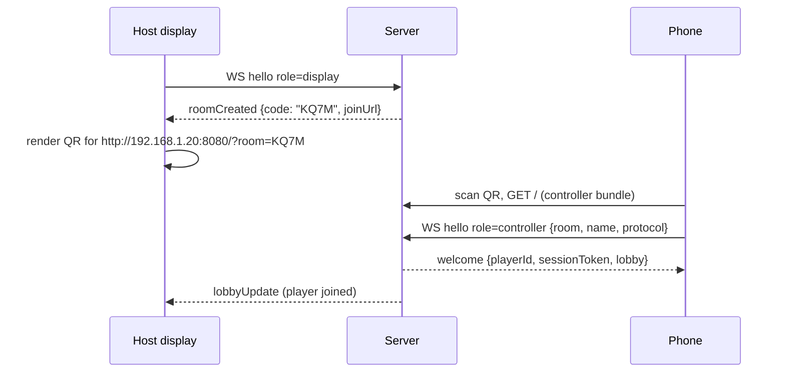

# Networking

Transport is WebSocket carrying JSON over the LAN ([ADR-0003](adr/0003-phone-web-controller-over-lan.md)). The server is authoritative; clients send intents.

## LAN IP discovery

The server enumerates `os.networkInterfaces()` and picks the best IPv4 address:

1. Skip internal (loopback), link-local (`169.254.0.0/16`) and interfaces with names matching `docker|veth|vmnet|vboxnet|utun|tailscale|zt` unless nothing else exists.
2. Prefer private ranges: `192.168.0.0/16`, then `10.0.0.0/8`, then `172.16.0.0/12`.
3. Prefer interfaces named `wlan*`, `en0`, `Wi-Fi`, `Ethernet`.
4. If several candidates remain, the first is used and all are exposed at `GET /api/info` and shown in the host UI so the host can switch (hosts with VPNs/VMs often have several).

Server binds `0.0.0.0` on a configurable port (default `8080`, env `SNAILS_PORT`).

## Join flow and QR code



The join URL is `http://<host-lan-ip>:<port>/?room=CODE`, rendered as a QR code on the display (server-generated SVG/data URL via the `qrcode` package). The URL and code are also shown in text for manual entry.

## Room codes

- 4 characters from an unambiguous alphabet (`ABCDEFGHJKMNPQRSTUVWXYZ23456789`, no `0/O/1/I/L`), about 700k combinations, case-insensitive.
- Generated by the server from a crypto-secure source, unique among active rooms, released when the room closes (idle > 30 min with no connections).
- A code is required to join; wrong codes are rate-limited (5 failures per IP per minute, then 30 s back-off).

## Remembered settings (M8-12)

The host's last-used lobby settings (turn time, rules, map style, seed, control mode; files saved before a setting existed load with its default) are remembered by the **server**, not the display's localStorage: it creates the room and owns the settings, so no extra display-to-server message is needed, and it does not depend on a stable browser origin (the desktop app may fall back from port 3000, which would change the origin and silently drop localStorage). They are written atomically to `lobby-settings.json` in `SNAILS_DATA_DIR`, defaulting to `%APPDATA%\Snails`, `~/Library/Application Support/Snails` or `$XDG_CONFIG_HOME/snails`; invalid or corrupt files are ignored. New rooms start from them. The display's audio mute/volume stay in localStorage (`snails.audio`; keys `M`, `[`, `]`), where an origin change only resets a preference. Phone preferences live in one versioned record `snails.prefs.v1` (legacy keys are migrated).

## Roles

| Role | Created by | Can send | Receives |
| --- | --- | --- | --- |
| `display` | Host app | `hello`, `lobbyConfig` (host options), `resync`, ack of VFX completion if needed | Snapshots, deltas, events, lobby |
| `controller` | Phone | `hello`, lobby/team edits, in-turn intents for the players it controls, `ping`, `resync` | Same snapshots, deltas, terrain edits and event stream as the display ([ADR-0008](adr/0008-phone-renders-game-view.md)), plus `playerView` for controlled players, lobby, errors |
| `spectator` | Phone/browser (`?role=spectator`) | `hello`, `ping` | Public view only |

One controller connection may control several players (hot-seat: one phone, multiple teams); the server checks every intent against the players bound to that session. A room has exactly one `display`; a second display `hello` is refused unless the first has been gone for the reconnect window.

## Message envelope and versioning

Every message uses one envelope, defined in `@snails/protocol`:

```ts
const Envelope = z.object({
  v: z.number().int(),            // PROTOCOL_VERSION of the sender
  t: z.string(),                  // message type discriminator, e.g. "intent.fire"
  id: z.string().optional(),      // client-generated, echoed in acks/errors
  seq: z.number().int().optional(),// server -> client sequence for gap detection
  p: z.unknown(),                 // payload, validated by the per-type schema
});
```

Example client message: `{"v":1,"t":"intent.aim","id":"c91","p":{"playerId":"p2","yaw":1.02,"pitch":0.61,"power":0.74}}`.

Validation pipeline for each inbound frame: size check (reject > 64 KiB) -> `JSON.parse` in try/catch -> envelope schema -> per-type schema from a `discriminatedUnion` -> semantic checks (session, turn ownership, resource availability) in the server. Failures return `{t:"error", p:{code, message, refId}}`; repeated garbage closes the socket with code 1008.

Versioning: `PROTOCOL_VERSION` is an integer incremented on any breaking schema change. The `hello` message carries it; the server answers `welcome` or `error{code:"version_mismatch", serverVersion}`. Because the server serves the controller bundle, phones normally match; a cached PWA with an old version is told to reload. Additive optional fields do not bump the version (schemas use `.passthrough()` off but unknown fields on newer clients are stripped).

## Reconnection

- On `welcome`, the server issues a `sessionToken` (128-bit random) bound to the player slot. The client stores it with the room code (`localStorage`).
- On socket loss the member is kept and marked `connected: false` in `lobbyState` (host is not reassigned on a blip). The client reconnects with exponential back-off (250 ms to 5 s, jitter) and sends `hello{roomCode, sessionToken}`.
- A `hello` with a known token and matching role/room re-attaches the same member (same `playerId`, team, colour, ready), closes any stale socket still holding that token (close code 1000, no disconnect handling), replies `welcome`, then sends `lobbyState` and, if a match is running, `matchStarted`, a fresh `snapshot`, `turnStart` and (during the action phase) `turnTimer` with the remaining time. An unknown or expired token, or a role mismatch, yields `error{bad_session}`; the controller client then clears its stored session and shows the join screen.
- Slot retention policy: a disconnected controller or display is removed after 60 s in the lobby, or 120 s while a match runs. Removal reassigns the host (if needed) and, when no controller remains in a running match, returns the room to the lobby.
- Turn policy: during a match a disconnected player keeps their slot and the turn timer keeps running. If it is a team's turn and none of its players is connected, the server ends that turn after a 10 s grace (retrying every second until the action phase); the normal turn timer may end it sooner. Reconnecting within the grace cancels the skip.
- Tokens are invalidated when the member is removed or the room closes.

## Heartbeats

The server sends a WebSocket protocol-level ping every 5 s; a connection with no inbound traffic (any message or pong) for 15 s is terminated, which marks the member disconnected as above. Browsers answer protocol pings automatically. Controllers additionally send application `ping{t}` and the server replies `pong{t}` so the phone can display RTT. Intervals are injectable (`HeartbeatOptions`) for tests.

## Bandwidth

Because phones render the world, each controller gets the same stream as the display: a full snapshot on join (terrain from seed plus edit list, typically tens of KB), then deltas at 20-30 Hz (a few KB/s while projectiles fly, near zero between turns) and events. With up to ~8 phones this is well under 1 Mbit/s each, trivial on LAN. Later optimisations: per-message delta compression against the last acked `seq`, binary encoding (MessagePack) for deltas, quantised transforms, and a lower delta rate for phones that report thermal/battery pressure (`hello.caps.maxDeltaHz`).

## Latency expectations

| Path | Target |
| --- | --- |
| Phone -> server one-way on good Wi-Fi | 5-20 ms typical, < 50 ms p95 |
| Intent -> visible on display (aim updates) | < 100 ms |
| Fire -> projectile spawn on display | < 150 ms |
| Display delta rate | 20-30 Hz, rendered interpolated at display refresh |
| Controller update rate for aim | throttled to 20 Hz, final value sent on release |

The game is turn-based, so latency tolerance is high; correctness (no desync) matters more than speed. Aim gestures are throttled and only the last value matters. Use `TCP_NODELAY` (default in `ws`) and disable `permessage-deflate` for small frames on LAN.

## LAN security

Threat model: casual mischief on a shared Wi-Fi, not a determined attacker.

- **No internet exposure.** The server must not be port-forwarded. Document this in the host UI and README. By default it listens on all interfaces because phones need it; an option `--lan-only` restricts accepted peers to private address ranges and rejects public source IPs.
- **Room code gate** for joining, with rate limiting (above). The host can lock the room once the game starts.
- **Session tokens** for reconnection; intents are always checked against the session's bound players.
- **Origin and size checks**: `ws` verifies `Origin` matches the served host:port; frames capped at 64 KiB; per-connection message rate limit (e.g. 60 msg/s, burst 120).
- **Host controls**: kick player, lock room, regenerate code.
- No accounts and no personal data; names are display strings only (sanitised and length-limited).
- Traffic is unencrypted HTTP/WS; do not use on untrusted networks (public cafe Wi-Fi with client isolation will also block joining). Optional later: self-signed local HTTPS for secure-context features.

### Windows firewall notes

On first run Windows Defender Firewall asks to allow the app: tick **Private networks** (home Wi-Fi) and leave Public unchecked. If phones cannot connect:

1. Check the PC's network profile is "Private", not "Public" (Settings > Network).
2. Add an inbound rule: `netsh advfirewall firewall add rule name="Snails" dir=in action=allow protocol=TCP localport=8080 profile=private`.
3. Confirm the phone and PC are on the same subnet and the router does not enable "AP/client isolation" (common on guest networks).
4. Try opening `http://<ip>:8080/api/info` from the phone browser to isolate firewall from app problems.

macOS shows a similar "accept incoming connections" prompt; Linux may need `ufw allow 8080/tcp`.

## Optional: mDNS (later)

Advertise `_snails._tcp` and a hostname like `snails.local` via `bonjour-service` so players can type `snails.local:8080`. Android Chrome resolves `.local` on most networks but not all, so the QR/IP URL remains the primary path. A future "Find games" screen could browse mDNS from a native wrapper; out of scope for the web controller.

## Private research state (M5)

Research is private. The server filters every outgoing message per recipient (`apps/server/src/game/privacy.ts`): snapshots carry `research` (preset) and `teams[]` with a public `researching` flag, but the per-team `research` object (Calcium, queue, active job) only goes to controllers of that team; displays get none, and a hot-seat phone (one phone, several teams) gets all of its teams. `calciumChanged`, `researchQueued`, `researchStarted` and `researchCancelled` events follow the same rule; `researchCompleted` is public. Catch-up snapshots on reconnect use the same filter. `queueResearch`/`cancelResearch {techId, seq?}` are accepted in any phase and routed to the sender team (the active team when the sender controls it).
