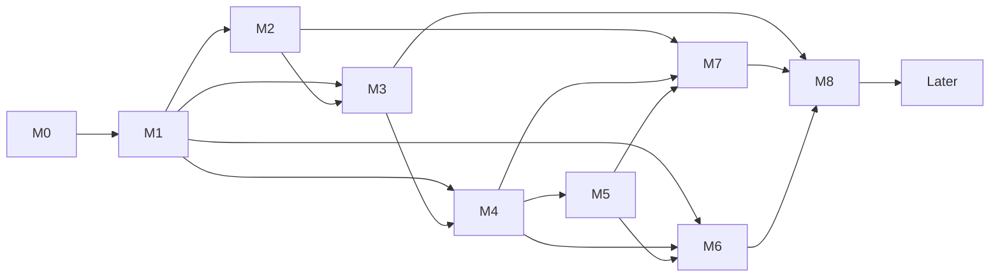

# Snails: Task Tracker

Everything needed to reach the first release (v0.1.0, end of M8) and beyond, grouped by the
milestones in [roadmap.md](roadmap.md). Each task is sized for one PR (about 0.5 to 2 days).

## How to use

- Status legend: ✅ done, 🚧 in progress (or a stub exists that needs real work), ⬜ todo.
- IDs are `M<milestone>-<nn>` and are stable. Never renumber; append new tasks at the end of a
  section. "Depends on" lists task IDs that must be merged first.
- Update the Status column in the same PR that does the work. Mention the task ID in the PR title.
- Keep this file in sync with [roadmap.md](roadmap.md): a milestone's exit criteria are the gate,
  and this file is the breakdown. If you change one, change the other.
- Area is the package, app or folder touched: `core`, `protocol`, `content`, `ai`, `render`,
  `server`, `display`, `controller`, `desktop`, `docs`, `ci`.

## M0: Repo scaffold and planning

| ID | Task | Area | Depends on | Status |
|---|---|---|---|---|
| M0-01 | pnpm workspace, Node 22, base tsconfig, Prettier, EditorConfig | ci | — | ✅ |
| M0-02 | ESLint with strict TS and `no-restricted-imports` package graph rules | ci | M0-01 | ✅ |
| M0-03 | `scripts/check-limits.mjs` enforcing file and function size limits | ci | M0-01 | ✅ |
| M0-04 | Vitest config and CI workflow (lint, typecheck, check-limits, test) | ci | M0-02, M0-03 | ✅ |
| M0-05 | Release workflow skeleton (tag `v*.*.*`, matrix build, GitHub Release upload) | ci | M0-04 | ✅ |
| M0-06 | Planning docs (vision, game design, architecture, networking, graphics, etc.) | docs | — | ✅ |
| M0-07 | ADRs 0001 to 0008 and ADR index/template | docs | M0-06 | ✅ |
| M0-08 | Package and app skeletons (core, protocol, content-base, ai, render, server, display, controller, desktop) | core | M0-01 | ✅ |
| M0-09 | Dependabot config and PR template | ci | M0-01 | ✅ |

## M1: Core sim vertical slice

Skeletons exist for the SDF grid, ballistics, RNG, event bus, registry and turn manager. They are
small and need the real behaviour below.

| ID | Task | Area | Depends on | Status |
|---|---|---|---|---|
| M1-01 | Define authoritative `GameState` (teams, snails, terrain, wind, turn, tick) and serialisable snapshot type | core | M0-08 | ✅ |
| M1-02 | Fixed-timestep `Simulation.step(dt)` driver with command queue, no wall-clock use | core | M1-01 | ✅ |
| M1-03 | Seeded RNG streams per subsystem (terrain, wind, crates, AI) with state save/restore | core | M0-08 | ✅ |
| M1-04 | SDF voxel grid: dimensions, chunking, dirty flags, sampling and gradient | core | M0-08 | ✅ |
| M1-05 | Sphere carving into the SDF grid with dirty-chunk reporting | core | M1-04 | ✅ |
| M1-06 | Seeded procedural terrain generator (hills, caves, water level) | core | M1-04, M1-03 | ✅ |
| M1-07 | Terrain collapse stub (unsupported voxel clusters fall or are removed) | core | M1-05 | ✅ |
| M1-08 | Terrain collision queries (ray cast, sphere sweep, ground normal) | core | M1-04 | ✅ |
| M1-09 | Snail entity: health, team, position, facing, alive flag | core | M1-01 | ✅ |
| M1-10 | Snail movement: crawl on terrain surface, slope limit, jump | core | M1-08, M1-09 | ✅ |
| M1-11 | Fall damage and drowning rules | core | M1-10 | ✅ |
| M1-12 | Ballistic projectile stepping with gravity, wind and terrain hit | core | M1-02, M1-08 | ✅ |
| M1-13 | Explosion resolution: damage falloff, knockback, terrain carve, events | core | M1-05, M1-12, M1-09 | ✅ |
| M1-14 | Turn manager phases (intro, action, fire, resolve, retreat, settle) with timer | core | M1-02 | ✅ |
| M1-15 | Team rotation, round-robin snail selection, skip dead teams | core | M1-14 | ✅ |
| M1-16 | Seeded wind that changes per turn | core | M1-03, M1-14 | ✅ |
| M1-17 | Typed `EventBus` events (turn, damage, terrain carve, death, win) | core | M0-08 | ✅ |
| M1-18 | `ContentRegistry` skeleton and definition types for weapons | core | M0-08 | ✅ |
| M1-19 | Pebble Toss weapon wired through registry, commands and projectile | core | M1-12, M1-13, M1-18 | ✅ |
| M1-20 | Win condition (last team standing) and draw handling | core | M1-13, M1-15 | ✅ |
| M1-21 | Command validation layer (`move`, `aim`, `fire`, `endTurn`) with rejection reasons | core | M1-02, M1-14 | ✅ |
| M1-22 | Headless full-match test from a seed with a scripted bot | core | M1-19, M1-20, M1-21 | ✅ |
| M1-23 | Replay recorder and identical-replay test | core | M1-22 | ✅ |
| M1-24 | Property tests: carving and projectile determinism | core | M1-05, M1-12 | ✅ |
| M1-25 | Coverage gate (90% lines on core rules) and step-time benchmark under 1 ms | ci | M1-22 | ✅ |

## M2: Display rendering

`@snails/render` has only a view stub, a placeholder snail mesh and quality tiers. The display app
is a stub client.

| ID | Task | Area | Depends on | Status |
|---|---|---|---|---|
| M2-01 | Render scene graph, renderer init, resize, render loop with injectable state source | render | M0-08 | ✅ |
| M2-02 | Snapshot interpolation buffer for smooth rendering between sim snapshots | render | M2-01, M1-01 | ✅ |
| M2-03 | Marching cubes mesher (pure function over chunk data) | render | M1-04 | ✅ |
| M2-04 | Web Worker chunk meshing with transferable buffers and dirty-chunk queue | render | M2-03 | ⬜ |
| M2-05 | Terrain materials and triplanar shading | render | M2-04 | ⬜ |
| M2-06 | Chunk rebuild budget scheduler (stay under 8 ms per frame) | render | M2-04 | ⬜ |
| M2-07 | Apply carve events to the local terrain copy and remesh | render | M2-04, M1-05 | ⬜ |
| M2-08 | Placeholder snail meshes with team colours, health bars and name tags | render | M2-01 | ✅ |
| M2-09 | Projectile and explosion rendering (basic particles, flash) | render | M2-01, M1-13 | ⬜ |
| M2-10 | Camera rig: follow, free, cinematic modes | render | M2-01 | ⬜ |
| M2-11 | Water plane and basic lighting with shadows | render | M2-01 | ⬜ |
| M2-12 | Wind particles driven by wind state | render | M2-01 | ⬜ |
| M2-13 | Quality tier implementation (high, medium, low, mobile) applied to renderer | render | M2-01 | 🚧 |
| M2-14 | Display app: Vite config, mount `@snails/render`, connect as `display` role | display | M2-01, M3-04 | 🚧 |
| M2-15 | Scripted-match render harness with 16 snails and FPS/chunk-stall overlay | display | M2-06, M2-08, M2-14 | ⬜ |
| M2-16 | Dependency check that render owns no game rules (lint rule and test) | ci | M2-01 | ✅ |
| M2-17 | Performance pass to hit 60 fps at 1080p on mid-range laptop | render | M2-15 | ⬜ |

## M3: Phone controller loop over LAN, with phone rendering

Server today: Fastify `/api/info`, a room manager, a `GameSession` stub that does not run the
loop or broadcast snapshots and events. The controller has stub net and turn-control modules.

| ID | Task | Area | Depends on | Status |
|---|---|---|---|---|
| M3-01 | Protocol: zod schemas for client and server messages, version constant | protocol | M0-08 | 🚧 |
| M3-02 | Protocol: snapshot, event batch and carve-event messages with compact encoding | protocol | M3-01, M1-01 | ⬜ |
| M3-03 | Protocol version handshake and mismatch error | protocol | M3-01 | ⬜ |
| M3-04 | Server WebSocket endpoint with envelope validation and role assignment | server | M3-01 | 🚧 |
| M3-05 | Room manager: create, join, room codes, player slots, display/controller roles | server | M3-04 | 🚧 |
| M3-06 | LAN IP detection (skip virtual adapters, multiple NICs) and `/api/info` | server | M0-08 | 🚧 |
| M3-07 | QR join code generation and join URL on the display lobby screen | server | M3-06, M3-05 | ⬜ |
| M3-08 | Real `GameSession`: fixed-step loop running core sim, applying validated intents | server | M1-21, M3-05 | 🚧 |
| M3-09 | Broadcast snapshots and events to all clients (display and controllers) | server | M3-02, M3-08 | ⬜ |
| M3-10 | Turn authorisation: only the active player's controller can command | server | M3-08 | ⬜ |
| M3-11 | Heartbeats, disconnect detection and player timeout policy | server | M3-04 | ⬜ |
| M3-12 | Reconnect and rejoin with session token; restore turn state within 3 s | server | M3-05, M3-09, M3-11 | ⬜ |
| M3-13 | Serve built controller bundle with caching headers and SPA fallback | server | M3-06 | ⬜ |
| M3-14 | Controller Vite dev server proxy for `/ws` and `/api` to the server | controller | M3-04 | ⬜ |
| M3-15 | Controller net client: connect, reconnect backoff, typed messages | controller | M3-01, M3-14 | 🚧 |
| M3-16 | Controller join screen (name, room code, QR deep link) | controller | M3-15, M3-05 | ⬜ |
| M3-17 | Controller lobby (team setup, colours, ready, host start) | controller | M3-16 | ⬜ |
| M3-18 | Lobby and match settings handling on the display and server | display | M3-17, M3-07 | ⬜ |
| M3-19 | Phone 3D view via `@snails/render` (lazy loaded, mobile tier) | controller | M2-13, M3-15, M2-04 | ⬜ |
| M3-20 | Phone camera modes: follow, aim, free; minimap and HUD overlays | controller | M3-19, M2-10 | ⬜ |
| M3-21 | Own-turn controls: joystick move, jump, aim drag, power, fire | controller | M3-19, M3-10 | 🚧 |
| M3-22 | Weapon picker UI and turn timer display | controller | M3-21, M1-18 | ⬜ |
| M3-23 | Waiting and spectating screen with other players' turn view | controller | M3-19 | ⬜ |
| M3-24 | Aim preview mirroring to display (throttled aim deltas) | server | M3-21, M3-09 | ⬜ |
| M3-25 | Haptics and basic audio cues with graceful degradation | controller | M3-21 | ⬜ |
| M3-26 | Quality auto-scaling and battery saver on phone | controller | M3-19, M2-13 | ⬜ |
| M3-27 | PWA: generate icons, finalise manifest, add service worker for offline shell | controller | M3-13 | ⬜ |
| M3-28 | Hot-seat and one-phone-per-player modes | controller | M3-17, M3-10 | ⬜ |
| M3-29 | Display app consumes snapshots and events and drives the shared renderer | display | M2-02, M3-09 | ⬜ |
| M3-30 | Latency instrumentation (command-to-effect histogram) and debug overlay | server | M3-09, M3-21 | ⬜ |
| M3-31 | Playwright smoke test: server, display and two simulated controllers play a turn | ci | M3-29, M3-21 | ⬜ |
| M3-32 | Real-device test on 2 to 4 Android phones (latency, 20 min thermal run, reconnect) | docs | M3-26, M3-30, M3-12 | ⬜ |
| M3-33 | Safari/iOS compatibility pass for the controller | controller | M3-21 | ⬜ |

## M4: Weapons and content packs

`@snails/content-base` holds a definitions stub with a small validated set.

| ID | Task | Area | Depends on | Status |
|---|---|---|---|---|
| M4-01 | Zod schemas for weapon, material, crate and wind definitions | content | M1-18 | 🚧 |
| M4-02 | Content pack manifest (id, version, deps) and loader validation | core | M4-01 | ⬜ |
| M4-03 | Effect vocabulary (damage, carve, status, spawn, move) kept small | core | M4-01, M1-13 | ⬜ |
| M4-04 | Pebble Toss and Salt Shaker as pure data (cluster, salt status) | content | M4-03, M1-19 | 🚧 |
| M4-05 | Slime Grenade (thrown, fuse, slow status) | content | M4-03 | ⬜ |
| M4-06 | Pebble Roller (bouncing, fuse) | content | M4-03, M1-08 | ⬜ |
| M4-07 | Radula Missile (guided steering input) | content | M4-03, M3-21 | ⬜ |
| M4-08 | Spore Cloud (lingering area effect over turns) | content | M4-03 | ⬜ |
| M4-09 | Shell Drill (digger tunnel) | content | M4-03, M1-05 | ⬜ |
| M4-10 | Shell Bash (melee, knockback) | content | M4-03 | ⬜ |
| M4-11 | Slime Rope (utility, swing or climb) | content | M4-03, M1-10 | ⬜ |
| M4-12 | Dew Bomb (temporary puddle, drowning, extinguish salt) | content | M4-03 | ⬜ |
| M4-13 | Beetle Barrage and Snail Mail (research-unlocked, telegraphed) | content | M4-03 | ⬜ |
| M4-14 | Crates and pickups (drop rules, health, ammo, weapon crates) | core | M4-01, M1-20 | ⬜ |
| M4-15 | Ammo and inventory model plus phone weapon picker integration | core | M4-04, M3-22 | ⬜ |
| M4-16 | Terrain materials (dirt, rock, sand) with differing carve resistance | core | M4-01, M1-05 | ⬜ |
| M4-17 | Match settings model and Classic mode complete | core | M4-14, M3-18 | ⬜ |
| M4-18 | Sudden death (rising water or health drain) | core | M4-17 | ⬜ |
| M4-19 | Per-weapon simulation tests and a playable demo map with every weapon | content | M4-05, M4-06, M4-07, M4-08, M4-09, M4-10, M4-11, M4-12 | ⬜ |
| M4-20 | Extensibility walkthrough verification: add a weapon with only a data file | docs | M4-19 | ⬜ |

## M5: Research and tech tree

| ID | Task | Area | Depends on | Status |
|---|---|---|---|---|
| M5-01 | Calcium economy: income sources, per-team balance, events | core | M4-17 | ⬜ |
| M5-02 | Tech definition schema (tier, branch, cost, prerequisites, effects) | content | M4-01 | ⬜ |
| M5-03 | Research queue: queueing, progress per turn, completion events | core | M5-01, M5-02 | ⬜ |
| M5-04 | Tier gating and branch prerequisites, capstone limits | core | M5-03 | ⬜ |
| M5-05 | Tech effect application (stat modifiers, weapon unlocks, hooks) | core | M5-03, M4-03 | ⬜ |
| M5-06 | Implement 20 techs across Weaponry, Shell, Mobility, Utility (first 10) | content | M5-05 | ⬜ |
| M5-07 | Implement remaining techs and the four capstones | content | M5-06 | ⬜ |
| M5-08 | Research race game mode and win rule | core | M5-04, M4-17 | ⬜ |
| M5-09 | Anti-snowball rules (catch-up income, cost scaling, stalemate pressure) | core | M5-05 | ⬜ |
| M5-10 | Protocol messages for private research state, queues and reveals | protocol | M5-03, M3-02 | ⬜ |
| M5-11 | Server: per-team private state filtering in snapshots | server | M5-10, M3-09 | ⬜ |
| M5-12 | Phone research screen (tree view, queue, hold-to-reveal for hot-seat) | controller | M5-10, M3-28 | ⬜ |
| M5-13 | Display research feedback (reveal moments, tech unlock VFX) | display | M5-03, M2-09 | ⬜ |
| M5-14 | Headless balance runner and dashboard output (win rates per tech) | ci | M5-07, M6-12 | ⬜ |
| M5-15 | Balance tuning pass; match with research completes under 30 min | docs | M5-14 | ⬜ |

## M6: CPU players

`@snails/ai` has a `CpuPlayer` stub and strategy placeholders. There is no headless AI match
runner command yet.

| ID | Task | Area | Depends on | Status |
|---|---|---|---|---|
| M6-01 | `CpuPlayer` interface and server integration (CPU teams submit intents) | ai | M3-08, M1-21 | 🚧 |
| M6-02 | State forking in core (cheap clone for lookahead) | core | M1-02 | ⬜ |
| M6-03 | Ballistic aiming solver (angle and power for target, wind aware) | ai | M6-02, M1-12 | ⬜ |
| M6-04 | Target selection scoring (damage, kill chance, risk) | ai | M6-03 | 🚧 |
| M6-05 | Movement planning (reach vantage points, avoid water and falls) | ai | M6-02, M1-10 | ⬜ |
| M6-06 | Weapon choice per situation | ai | M6-04, M4-19 | ⬜ |
| M6-07 | Difficulty levels (Rookie, Regular, Veteran, Mastermind) via error and lookahead | ai | M6-03 | ⬜ |
| M6-08 | Personalities (aggressive, cautious, opportunist) | ai | M6-04 | ⬜ |
| M6-09 | Research strategy for CPUs | ai | M5-05, M6-04 | ⬜ |
| M6-10 | Think-time budget and p99 under 250 ms benchmark | ai | M6-07 | ⬜ |
| M6-11 | Lobby UI for adding CPU teams with difficulty and personality | controller | M6-01, M3-17 | ⬜ |
| M6-12 | Headless AI match runner command (`pnpm sim:ai`) with seeds, JSON output | ai | M1-22, M6-07 | ⬜ |
| M6-13 | CI gate: Mastermind beats Rookie in at least 90% of matches | ci | M6-12 | ⬜ |

## M7: Shell visual system and polish

| ID | Task | Area | Depends on | Status |
|---|---|---|---|---|
| M7-01 | Procedural shell geometry generator (spiral params from seed) | render | M2-08 | ⬜ |
| M7-02 | Shell patterns and team colour system | render | M7-01 | ⬜ |
| M7-03 | Material tiers (basic, reinforced, crystal, armoured) driven by tech state | render | M7-01, M5-05 | ⬜ |
| M7-04 | Attachments and decals (antennae, flags, scratches) | render | M7-02 | ⬜ |
| M7-05 | Crack shader with 4 damage states | render | M7-01, M1-13 | ⬜ |
| M7-06 | Fragment spawning on damage and critical state visuals | render | M7-05 | ⬜ |
| M7-07 | Death shells and death sequence | render | M7-06, M1-20 | ⬜ |
| M7-08 | Snail body animation set (crawl, jump, aim, hurt, retreat) | render | M2-08 | ⬜ |
| M7-09 | Expression system (eyes and stalks reacting to events) | render | M7-08, M1-17 | ⬜ |
| M7-10 | Weapon and explosion VFX pass | render | M2-09, M4-19 | ⬜ |
| M7-11 | Audio system, SFX and music pass on display and phone | display | M3-25, M7-10 | ⬜ |
| M7-12 | King of the Hill mode | core | M4-17 | ⬜ |
| M7-13 | Post-processing (bloom, tone mapping, outline) on high tier | render | M2-11 | ⬜ |
| M7-14 | Readability review at TV distance and on phone for tiers and cracks | docs | M7-05, M7-03 | ⬜ |
| M7-15 | Quality tier budget verification on display and phone | render | M7-13, M3-26 | ⬜ |
| M7-16 | Accessibility pass (colour-blind team markers, text size, reduced motion) | controller | M3-23 | ⬜ |

## M8: Packaging and first release

The desktop app currently loads the display from the dev URL rather than a bundled build.
electron-builder config exists but `dist` has never been run end to end.

| ID | Task | Area | Depends on | Status |
|---|---|---|---|---|
| M8-01 | Desktop main process starts the server in-process and picks a free port | desktop | M3-13 | 🚧 |
| M8-02 | Desktop loads the bundled display build (no dev URL) | desktop | M8-01 | ⬜ |
| M8-03 | Bundle server and controller assets via `extraResources` and verify paths | desktop | M8-02, M3-27 | ⬜ |
| M8-04 | Verify `electron-builder` dist on Linux (AppImage) | desktop | M8-03 | ⬜ |
| M8-05 | Verify dist on Windows (NSIS) and macOS (dmg) via CI matrix | ci | M8-04 | ⬜ |
| M8-06 | Release workflow hardening (version from tag, checksums, release notes) | ci | M8-05 | 🚧 |
| M8-07 | Installer smoke test in CI (launch, hit `/api/info`, quit) | ci | M8-05 | ⬜ |
| M8-08 | First-run screen with LAN IP, QR and firewall guidance | desktop | M3-07, M8-02 | ⬜ |
| M8-09 | Windows firewall prompt handling and troubleshooting doc | docs | M8-08 | ⬜ |
| M8-10 | Tutorial overlay on phone and display | controller | M7-11, M3-22 | ⬜ |
| M8-11 | Default settings tuning from playtests | docs | M5-15, M8-10 | ⬜ |
| M8-12 | Settings persistence (host and phone) | desktop | M8-02 | ⬜ |
| M8-13 | Code signing decision and unsigned-install guidance | docs | M8-05 | ⬜ |
| M8-14 | Update release-process doc and write README quickstart | docs | M8-06 | ⬜ |
| M8-15 | Non-developer install test: install to playing in under 5 minutes | docs | M8-08, M8-11, M8-07 | ⬜ |
| M8-16 | Tag v0.1.0 and publish GitHub Release | ci | M8-15, M8-14 | ⬜ |

## Later

| ID | Task | Area | Depends on | Status |
|---|---|---|---|---|
| L-01 | Online play: relay or WebRTC room codes | server | M8-16 | ⬜ |
| L-02 | Latency-tolerant sync for online play | server | L-01 | ⬜ |
| L-03 | Mod loading from disk with sandboxing rules | core | M4-02, M8-16 | ⬜ |
| L-04 | Workshop-like content pack index | docs | L-03 | ⬜ |
| L-05 | Android TWA or Capacitor wrapper for the controller | controller | M3-27, M8-16 | ⬜ |
| L-06 | In-game map editor (3D terrain painter) | display | M1-06, M8-16 | ⬜ |
| L-07 | Shareable map seeds | core | L-06 | ⬜ |
| L-08 | Replay viewer from recorded matches | display | M1-23, M8-16 | ⬜ |
| L-09 | Spectator-share link | server | L-01, L-08 | ⬜ |
| L-10 | mDNS discovery on LAN | server | M8-16 | ⬜ |
| L-11 | WebGPU renderer migration path | render | M8-16 | ⬜ |
| L-12 | More modes and seasonal content | content | L-03 | ⬜ |

## Milestone dependencies

M5 and M6 are loosely coupled (CPU research strategy and the balance runner); M6 core work can
start once M4 is done.

## Critical path to a first playable LAN match

The shortest chain to 2 to 4 phones playing a Classic match with Pebble Toss (end of M3):

1. M1-04, M1-05, M1-08: terrain and collision
2. M1-10, M1-12, M1-13: movement, projectile, explosions
3. M1-14, M1-21, M1-19, M1-20: turns, commands, Pebble Toss, win
4. M1-22: headless match test
5. M3-01, M3-02, M3-04, M3-05: protocol, WebSocket, rooms
6. M3-08, M3-09, M3-10: game loop, snapshots and events broadcast, turn authorisation
7. M2-03, M2-04, M2-07: terrain meshing and carve events
8. M3-14, M3-15, M3-16, M3-17: controller proxy, net, join, lobby
9. M3-19, M3-21: phone 3D view and own-turn controls
10. M3-29: display consumes snapshots
11. M3-32: real-device LAN playtest

After that, the path to v0.1.0 continues through M4-19, M5-15, M6-13, M7-15, M8-04, M8-15, M8-16.
